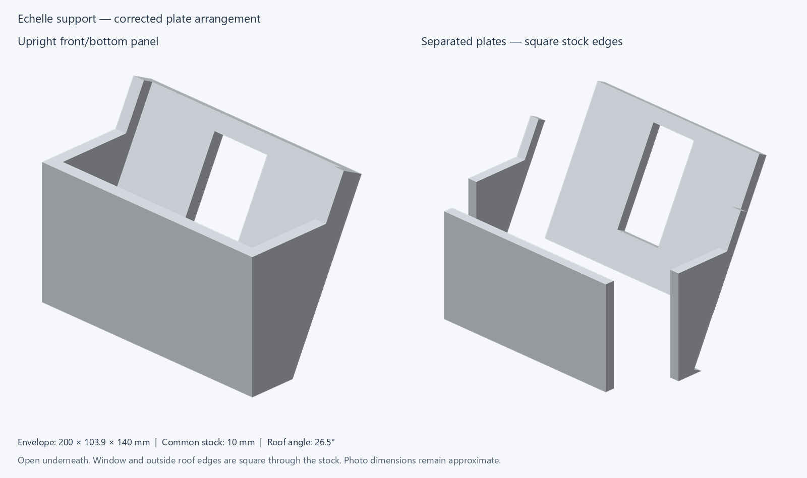

# Echelle grating support

Open `echelle-grating-support.iam` with `PIHTI.ipj` active.
The assembly contains four aluminum plates in three part types:

| File | Quantity | Role |
| --- | ---: | --- |
| `echelle-support-base.ipt` | 1 | Upright front/left bottom plate; shared driving parameters |
| `echelle-support-roof.ipt` | 1 | Angled roof with the grating opening |
| `echelle-support-side.ipt` | 2 | Profiled side plates with projecting arms |

The envelope is approximately **200 × 103.9 × 140 mm**. Common stock is
provisionally **10 mm**; the roof opening is **50 × 100 mm**. These dimensions
are photo estimates, not measured fabrication dimensions. The **26.5°** angle
comes from the owner's original sketch. Aluminum 6061 is a reference material;
the actual alloy is unconfirmed. Fasteners and the adjustment stage are omitted.
The bottom plate is the broad upright panel at the front/left, not a floor.
The space underneath stays open. The window plate is rectangular stock with
outside and opening edges perpendicular to its broad faces. Its normal-cut end
planes also define the mating ends of the side profiles. The roof plate blank
is approximately 200 × 147 × 10 mm; the front plate is 200 × 106 × 10 mm.

The reference photos are `IMG_20261120_185315.jpg`, `185451.jpg`, `185502.jpg`,
`185512.jpg`, `185532.jpg` and `185238.jpg` from the November 2026 phone archive.
The front and ruler views establish the approximate size and plate arrangement;
perspective and ruler position limit measurement accuracy.

Edit **User Parameters in `echelle-support-base.ipt`** for the common dimensions:
`StockThickness`, `SupportWidth`, `SupportHeight`, `RoofAngle`, `RoofFoot`,
`ArmHeight`, `ArmRoot`, `ArmTip`, `WindowWidth`, `WindowLength` and
`WindowCentreHeight`. `RoofEndHeight` and `RoofEndDepth` are calculated from the
normal end plane meeting the arm at `SupportHeight`; they are not independent
dimensions. The legacy `BaseDepth` parameter now equals `StockThickness`.
The roof, side part and assembly link those parameters
through native Inventor parameter tables. Update the assembly after editing.
Each part retains fully constrained, editable native sketches and extrusions.

`echelle-grating-mount-mockup.ipt` is the owner's original, preserved unchanged.
It remains a separate reference rather than a component of the new assembly.
STEP copies of the new assembly and all three parts are in the catalog's
configured STEP mirror.

Verified: healthy native features and relationships, resolved references, four
occurrences, no plate interference. Changing the shared thickness to 9 mm and
back to 10 mm updated all parts and the right-side position correctly.
STEP face-normal checks confirm that all roof edge faces, including the window
walls, are perpendicular to the broad plate faces.
