# Modular sensor box

Removable-panel development for a humidity sensor box and an ADC box with a divider, retaining the current enclosure size.

## Scope

Queezz wants two instruments using the current box dimensions, with small
changes to the module holding board. Front and rear panels must be replaceable
without loosening the electronics sandwich. The extra 5 mm at the front is
intentional wire space and must remain (owner, 2026-10-26).

One, two or three interaction buttons may later control the screen or change
pages. Button selection, button openings and printed covers are deferred.
The front carries the existing OLED and its mount. Rear access uses the owner's
final retained ready-panel opening geometry and finishing. Power and
thermocouple hardware remain excluded from the fixture.

## Prototype mounting design

- Each panel is a separate, editable Inventor part: 74 x 60 mm, 3 mm thick,
  with 5 mm corner radii and a 0.5 mm outer-face perimeter chamfer.
- Four inward returns attach each panel with side-access M3 screws. No panel
  fixing passes through the front or rear face. The sleeve covers the screw
  heads when installed.
- New upper and lower mount spacers use 7 x 13 mm rectangular blocks,
  each with one rod bore and one straight transverse screw pilot. There are
  no steps or collar recesses. Queezz added the printing/strength fillets and
  chamfers; those finishing features are preserved (owner, 2026-10-26).
  The spacers include the clamped thickness formerly
  supplied by the captured panel ears. Removing a panel therefore does not
  release the sandwich.
- The upper spacer is 17.49 mm long and the lower spacer is 24 mm long in the
  measured fit fixture. The original short spacers, shelf and outer sandwich
  plates remain shared.
- Panel screw axes are at x = +/-33.3 mm, z = +/-20 mm, with y = 45 mm at
  the front and -32 mm at the rear. Front blocks face outward into the corner
  wire-gap space so the front returns can be shorter; rear blocks face inward.
  Both ends reuse the same upper/lower parts. Panel screw axes are offset 6.5 mm
  from the sandwich rod axes, keeping their bores separate.
- Panel hardware is referenced directly from `ContentCenter/Fastners`: eight
  `M3x8-BHCS.ipt` screws, driven directly into the printed plastic. No heat-set
  inserts are used (owner, 2026-10-26).
- Plain screw pilots start at 2.5 mm diameter, controlled by the named
  `panel_screw_pilot` parameter in each spacer. This is a test-print starting
  value, to tune for the print and actual screw. Nominal screw/pilot overlap
  represents the thread formed in plastic, not a clearance fit.
- Queezz prefers a quick replacement spacer print if its plastic thread wears
  out, rather than retaining inserts (owner, 2026-10-26).

The front inner face remains at y = 50 mm; the rear inner face is at
y = -45 mm. The shelf ends at y = 45 mm, preserving the 5 mm front wire gap.
Front returns reach 8 mm inward; rear returns reach 16 mm inward. Both panels
now have 4 mm ears, growing outward from fixed spacer-contact faces. The key
user parameter `ear_thickness` directly drives the width of all four return
profiles, the screw clearance depth and the outer clearance plane. It replaces
`tab_thickness`, which had only driven the clearance cut, not the profiles.
The middle of the front wire gap remains clear. Screw seating faces in the
current fit assembly are at x = +/-34 mm.

The fit fixture uses grounded components. If `ear_thickness` is changed later,
update its screw positions to the new outer faces; the individual part's ears
and clearance cuts update through the parameter.

## Display and rear access

- The existing OLED, screen mount and four M2 screws are shared references
  in their original positions. The front preserves the proven snug seat:
  30 x 30 mm opening, 2 mm corner radii and 0.5 mm entry chamfers, matching
  the original panel. No OLED or mount geometry was changed. Do not enlarge
  this opening for clearance (owner, 2026-10-26).
- Rear opening geometry was transferred from
  `../esp32-ambient-logger/temp-logger-back-plate-v2.ipt`, including its
  chamfers, fillets and perimeter finishes. The donor is the owner's printed,
  working panel (owner, 2026-10-26). The current native part includes the owner's
  subsequent retained opening tools and final finishing; it is the print source.
  Do not replace those openings with estimated rectangles or resize their fits.
- Exact native solid cutters preserve the original opening surfaces in the
  new part; the consumed `Exact ready opening` features and their final cut
  are a geometry snapshot of the ready panel. The new removable ears and their
  owner finishing are retained. The source panel is not modified.
- The original whole-face transfer was verified against the donor within
  0.000001 mm3 before later owner edits. The final source hashes are in the
  print manifest. The modeled SD card clears the retained SD opening through
  a 20 mm withdrawal, ending fully outside the rear panel.

## Files and reuse

| File | Role |
| --- | --- |
| `sensor-box-front-panel.ipt` | OLED opening and short mounting returns |
| `sensor-box-back-panel.ipt` | Proven ready-panel face and openings with removable ears |
| `sensor-box-upper-mount-spacer.ipt` | Upper rod spacer and panel receiver; four instances |
| `sensor-box-lower-mount-spacer.ipt` | Lower rod spacer and panel receiver; four instances |
| `SensorBox-panel-fit.iam` | Mechanical inspection fixture using shared existing parts |
| `sensor-box-oled-sleeve-trial.ipt` | Active holder-aligned full sleeve trial; face-down STL in print bundle |
| `sensor-box-oled-cover-trial.ipt` | Optional low-lip friction-fit cover trial; excluded from the print bundle |

The fit fixture references unchanged enclosure and frame parts from
`../esp32-ambient-logger/`; it does not copy them into this folder. The existing
PCB (`TempLoggerRev1.iam`), ESP32, SD reader and RTC are also shared references,
retaining their existing positions (owner, 2026-10-26). The thermocouple plug,
thermocouple converter and DC jack are not brought into the new fixture. Its
components are deliberately grounded at measured positions for inspection.
It is not a constrained instrument assembly or a finished humidity/ADC design.
The humidity sensor needs exposure to outside air,
because conditions inside the enclosure differ; no extra space is required on
the red mounting plate (owner, 2026-10-26). Its specific mounting and wiring,
the ADC/divider board and instrument-specific cutouts remain to be designed.

Dimensions and feature sketches are native Inventor features. Panel width,
height, face thickness and screw clearance have named parameters. Mount
spacer length, rod clearance and screw pilot diameter also have named parameters.
The return profiles and offsets remain separately editable; changing the
box envelope requires reviewing those sketches and the fit assembly too.

## OLED cover design trial

Queezz requested a friction-fit display cover that hides the terminals and
bolts without burying the screen (owner, 2026-10-26). The optional
`OLED cover trial` occurrence is retained but hidden in the fit assembly.
The newer holder sleeve described below is visible. Existing parts and the finished STL bundle
are unchanged.

- A 22.4 x 12 mm viewing opening exposes the modeled 21.56 x 11.22 mm screen.
  The bevelled inner lip stands 0.7 mm above the glass. The surrounding face
  rises 1.5 mm above the glass to conceal the screw heads.
- There is 0.3 mm nominal glass clearance. Four hidden screw pockets and a
  terminal pocket leave a 0.8 mm roof over the hardware. The cover does not
  press on the glass or modify the original OLED mounting fit.
- The skirt slips over the PCB perimeter. Four local pads grip its side edges
  below the glass, with gentle 0.15 mm lead-ins and 0.05 mm nominal interference.
  Clearance elsewhere is 0.4 mm. Press on and pull off normal to the OLED face.
- Native checks show only the four intended pad contacts (0.315 mm3 total),
  all below the PCB front face. Setting pad interference to zero eliminates
  every cover contact; glass, bolts, terminals and mount remain clear.
- This is a design trial, not a physically validated friction fit. Tune the
  pad interference after a test print with the actual module.

Key parameters genuinely drive the native features:

| Parameter | Initial value | Controls |
| --- | ---: | --- |
| `screen_lip_height` | 0.7 mm | Actual aperture lip above glass, through the bevel |
| `fit_interference` | 0.05 mm | Four PCB-edge friction pads |
| `side_clearance` | 0.4 mm | Skirt clearance away from the pads |
| `wall_thickness` | 0.8 mm | Outside skirt wall |
| `roof_thickness` | 0.8 mm | Material over bolt and terminal pockets |
| `glass_gap` | 0.3 mm | Clearance above the screen |
| `window_width`, `window_height` | 22.4 x 12 mm | Viewing aperture |

`screen_lip_height` was tested at 0.6 mm and restored to 0.7 mm. Fit details
and native feature health are recorded in `oled-cover-trial-check.json`.

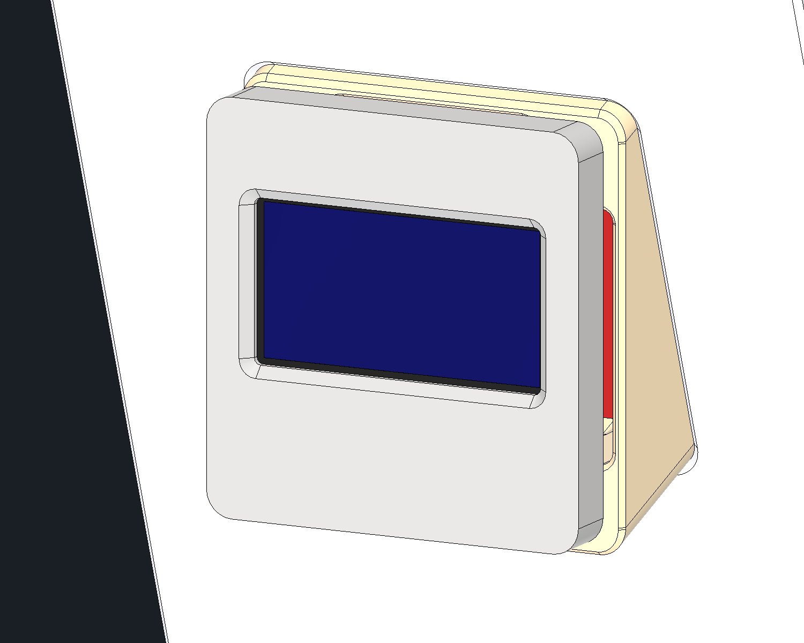

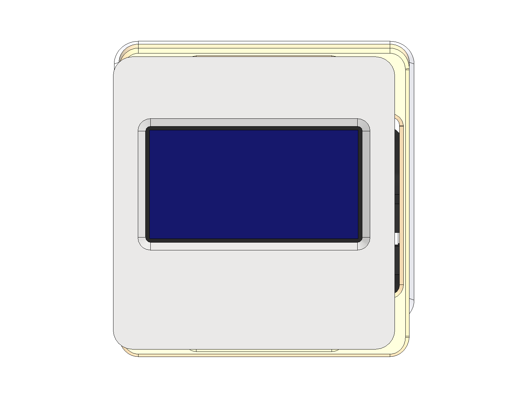

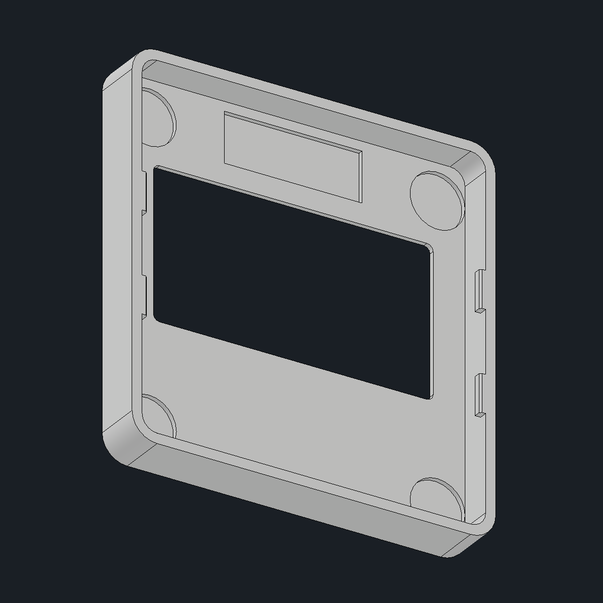

## Holder-aligned OLED sleeve

The sleeve covers the original holder and conceals the hardware. Its walls follow
the holder axis and the front matches the OLED tilt. The viewing opening is
now 22.4 x 13.5 mm: its top edge was raised
1.5 mm for visibility from above, with its bottom and width fixed. The low-lip
bevel is retained. The outer front edge is a 0.6 mm
chamfer driven by `front_edge_chamfer`.

The owner physically tuned the width and reported about 2 mm vertical play
(2026-10-27). That feedback supersedes the earlier photo-derived 32 mm estimate.
The owner's 30 mm cavity and 31.6 mm external width are retained. The side grips first centred the owner's 29.6 mm opening, correcting a
0.15 mm lateral bias. At the owner's further request, each knob now projects
0.5 mm more inward, giving a 28.6 mm horizontal opening with faces at X=±14.3 mm.

Two matching internal stops project 1 mm inward from the top and bottom walls.
They reduce the vertical opening from 30.6 to 28.6 mm while retaining the finished
outer shape. Key `vertical_fit_reduction` controls the total 2 mm take-up;
`vertical_grip_span` reports the resulting opening. `side_grip_span` drives the
centred side opening. Stops span 22 mm across. The upper stop now starts 0.65 mm farther
rearward, at Z=4.3 mm in the sleeve frame, so it reaches the short upper mount
wall. Its key `upper_grip_rear_gap` is 0.15 mm; the lower stop stays in place.
Existing owner finishing and screw pockets remain.

All 21 current features are healthy. Native sketch coordinates verify mirrored
side grips and equal inward projection of the top/bottom stops. The upper stop
has its own depth station to suit the shorter upper wall. The visibility-independent
BRep check finds no OLED, screw or front-panel overlap; intended mount contact
remains. Owner cover mates were preserved. The next print remains the
decisive friction-fit check. Earlier CAD and photo assumptions are
historical evidence in `oled-sleeve-trial-check.json`.

The high-resolution `sensor-box-oled-sleeve.stl` and complete ZIP in the linked
print bundle are refreshed, display face down at Z=0. The hidden first cap trial
is retained as a separate part for historical comparison; it is not printed.

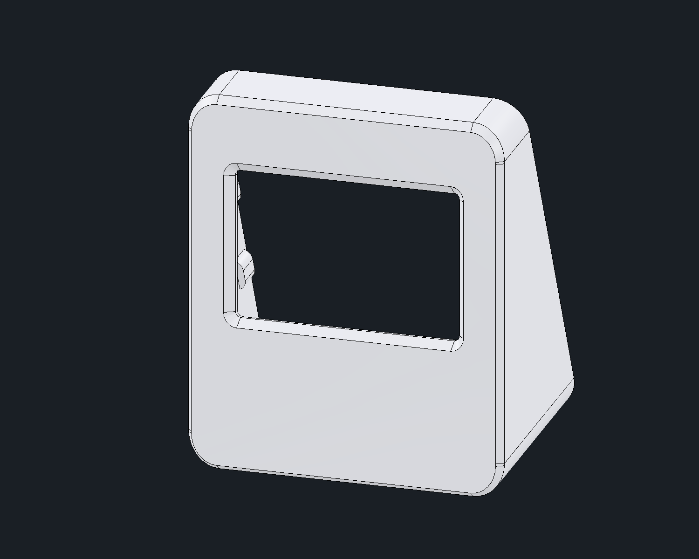

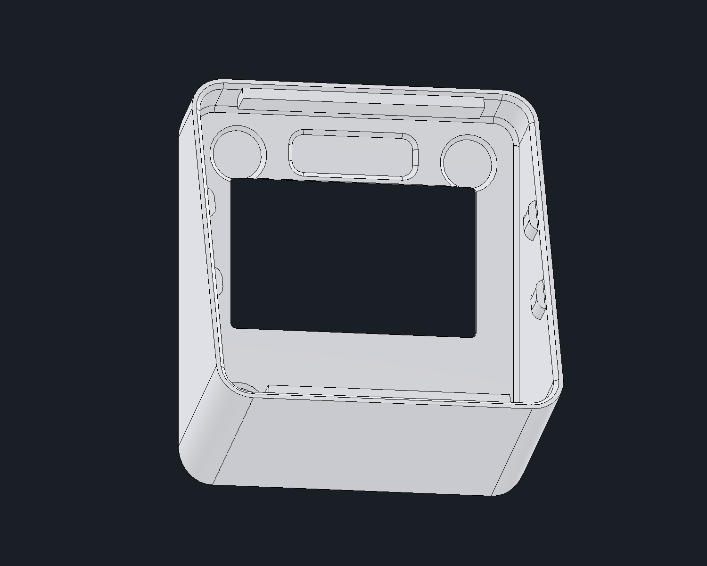

The current upper-grip/window revision is measured in
`oled-upper-grip-window-check.json`. Independent BRep intersections verify
clearance to the OLED, four M2 screws and front panel. Intended contact with
the mount remains; the isolated upper rib intersects the modeled mount by
7.18 mm3 versus 1.57 mm3 before. This measures geometry, not holding force.
`window_top_extension` controls the top-only enlargement. The hidden terminal
pocket's unused lower portion was trimmed 0.6 mm to preserve its 0.4 mm chamfer;
modeled terminal clearance remains. All 21 features are healthy.

## OLED reference model corrected to the proven mount

The printed `oled-screen-mount` and its holes are authoritative (owner,
2026-10-27). Its native hole pattern measures 21 x 23 mm; the downloaded OLED
had 23.1 x 23.56 mm pitch with a vertically biased pattern. The earlier image
measurements used that downloaded pitch and are superseded by the mount.

The shared imported OLED part now has four native hole corrections and two
matching upper copper-pad corrections. Its PCB outline, active screen,
connector and all eight bodies remain. The PCB is centred on the sloping mount
seat, with its underside on that plane. All four bore axes match the mount
within numerical precision. The four M2 screws follow those corrected axes.

The cover's original 12 mm aperture and terminal pocket moved 0.40321 mm down
to follow the correctly seated module; the later top-only 1.5 mm window extension
is intentional. At the alignment baseline, the hidden screw pockets now match 21 x 23 mm. Its
exterior, chamfer and side-knob dimensions remain. The actual active-screen face
was centred in the 12 mm baseline aperture; the current opening extends farther
above it for oblique viewing. Native cover
contacts are zero; tiny screw-to-PCB/copper seating overlaps remain. All 14 OLED
features, 21 cover features and owner cover mates are healthy. Detailed evidence
is in `oled-mount-alignment-check.json`. The face-down print STL and ZIP are
refreshed; physical friction fit remains a print test.

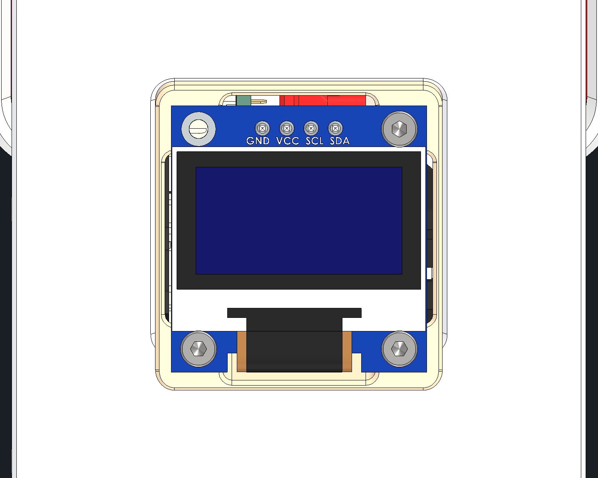

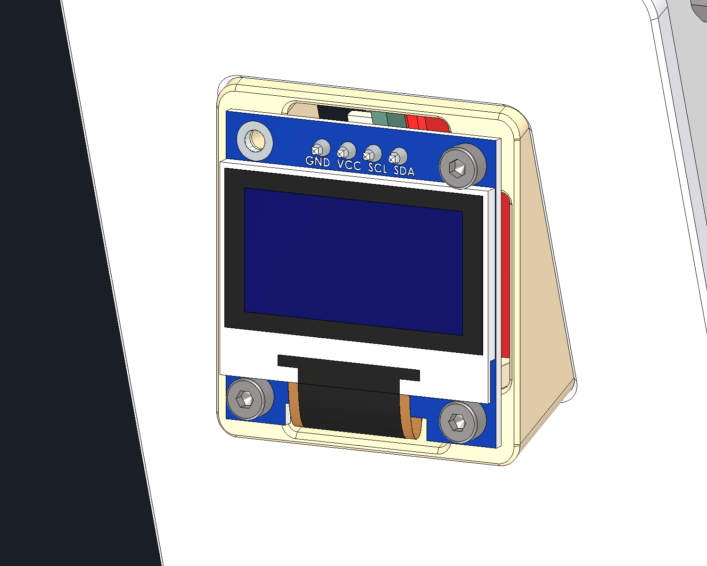

## Servicing

1. Slide off the enclosure sleeve.
2. Disconnect the selected panel's wiring as needed.
3. Remove that panel's four side screws.
4. Pull the panel straight outward, leaving the sandwich rod nuts tightened.

The sleeve must be removed for screw access. A change from the logger's old
captured ears to these mount spacers requires an initial sandwich rebuild;
subsequent panel changes do not.

## Finished print exports

The current, owner-finished parts and shared printed components are exported
in [`3D-printing/modular-sensor-box`](../../3D-printing/modular-sensor-box/README.md).
That bundle's source hashes and mesh validation identify the exact final print
geometry. Earlier fit comparisons below describe the development checks;
the owner's later finishing is retained in the final exports.

## Verification

Native checks and dimensions are recorded in `fit-check.json`. Final printing
checks and source hashes are in the linked print export manifest.

- All new part features are healthy; the saved fit assembly reopens with
  resolved references. Original logger CAD files remain unchanged.
- Panel withdrawal was checked at 0, 2, 10 and 30 mm outward, with panel screws
  removed and the sandwich left fixed. The OLED, mount and M2 screws travel
  with the front panel, which remains clear.
- Earlier rear ear-root contacts were cleared by the owner's final finishing
  and frame edits. The final seated assembly check has only the intentional
  snug OLED contact; sleeve fit and panel/card withdrawal are clear.
- SD withdrawal was checked at 0, 5, 10 and 20 mm through the rear opening.
- The new mounts clear the existing internal boards. The unchanged sleeve
  clears the assembled frame, panels, hardware and retained electronics at
  a measured sleeve centre of y = 2.8 mm.
- Intentional screw/plastic contact, existing simplified nut/rod overlap
  and the original snug OLED seat are distinguished from new collisions.
  The OLED mount's nominal contact matches the original assembly.
- Physical printing, plastic-thread durability, wiring clearance and tool use
  have not yet been verified on hardware.

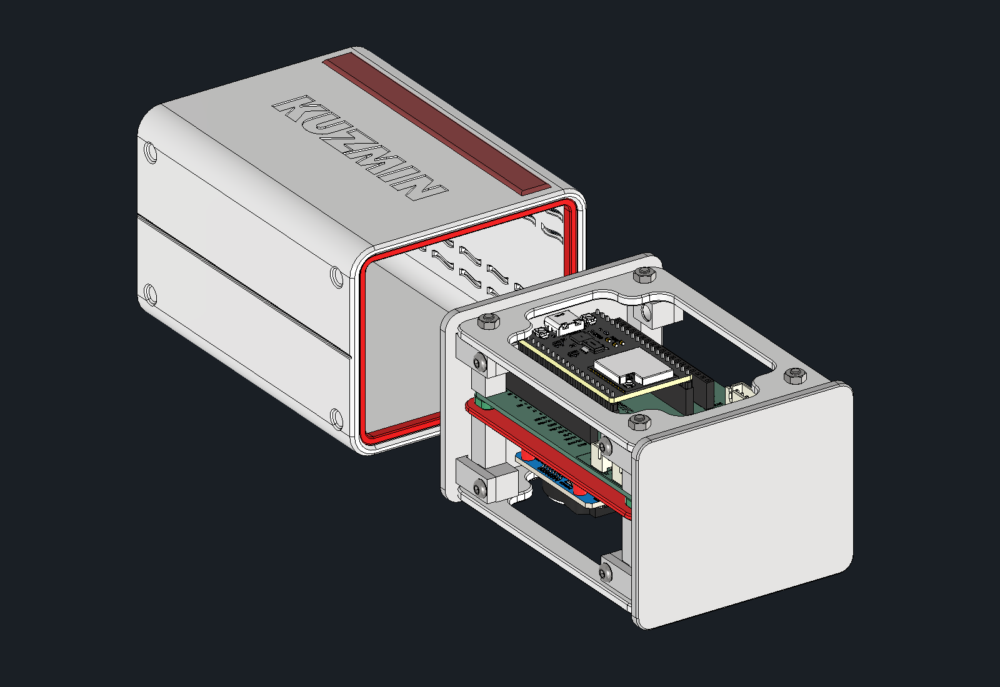

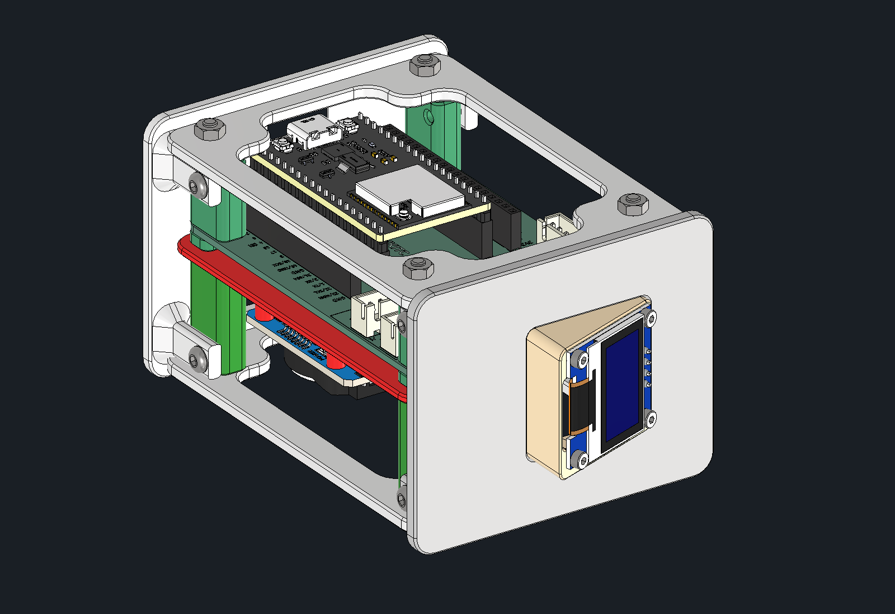

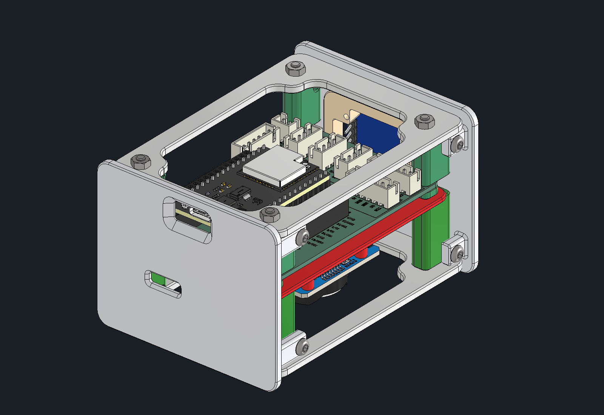

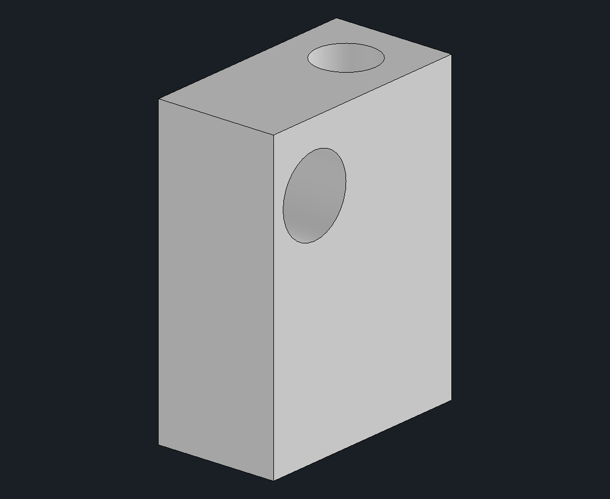
