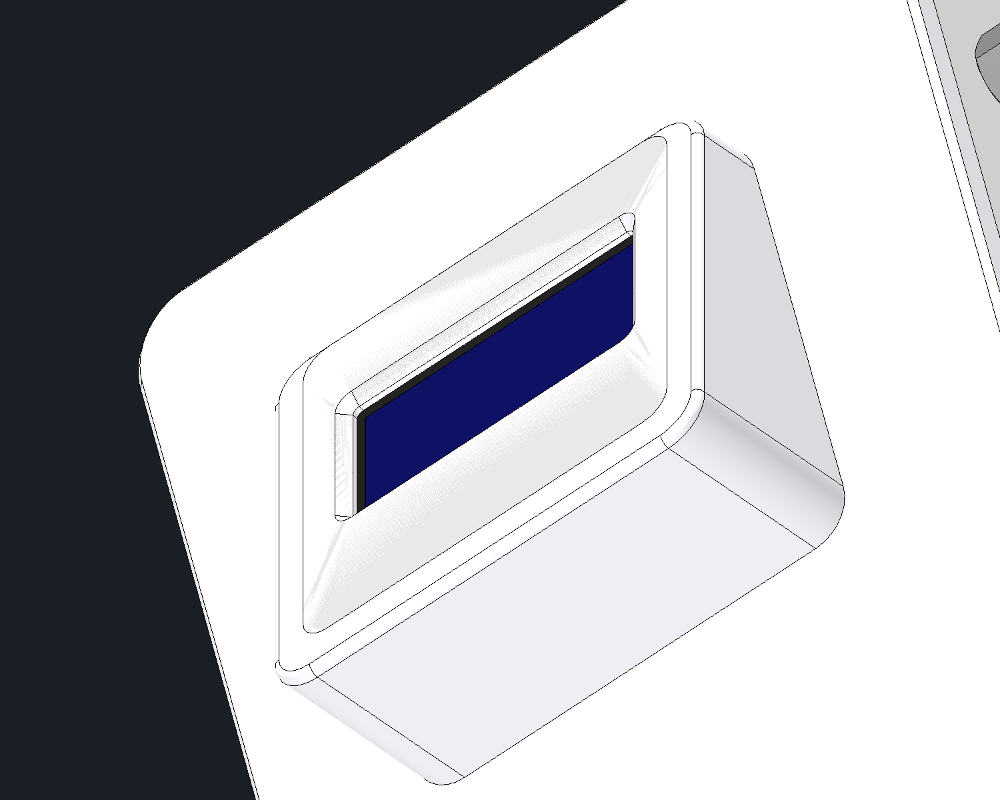

# Modular sensor box

Removable-panel development for a humidity sensor box and an ADC box with a divider, retaining the current enclosure size.

## Scope

Queezz wants two instruments using the current box dimensions, with small
changes to the module holding board. Front and rear panels must be replaceable
without loosening the electronics sandwich. The extra 5 mm at the front is
intentional wire space and must remain (owner, 2026-10-26).

One, two or three interaction buttons may later control the screen or change
pages. Button selection, button openings and printed covers are deferred.
The front carries the existing OLED and its mount. Rear access uses the owner's
final retained ready-panel opening geometry and finishing. Power and
thermocouple hardware remain excluded from the fixture.

## Prototype mounting design

- Each panel is a separate, editable Inventor part: 74 x 60 mm, 3 mm thick,
  with 5 mm corner radii and a 0.5 mm outer-face perimeter chamfer.
- Four inward returns attach each panel with side-access M3 screws. No panel
  fixing passes through the front or rear face. The sleeve covers the screw
  heads when installed.
- New upper and lower mount spacers use 7 x 13 mm rectangular blocks,
  each with one rod bore and one straight transverse screw pilot. There are
  no steps or collar recesses. Queezz added the printing/strength fillets and
  chamfers; those finishing features are preserved (owner, 2026-10-26).
  The spacers include the clamped thickness formerly
  supplied by the captured panel ears. Removing a panel therefore does not
  release the sandwich.
- The upper spacer is 17.49 mm long and the lower spacer is 24 mm long in the
  measured fit fixture. The original short spacers, shelf and outer sandwich
  plates remain shared.
- Panel screw axes are at x = +/-33.3 mm, z = +/-20 mm, with y = 45 mm at
  the front and -32 mm at the rear. Front blocks face outward into the corner
  wire-gap space so the front returns can be shorter; rear blocks face inward.
  Both ends reuse the same upper/lower parts. Panel screw axes are offset 6.5 mm
  from the sandwich rod axes, keeping their bores separate.
- Panel hardware is referenced directly from `ContentCenter/Fastners`: eight
  `M3x8-BHCS.ipt` screws, driven directly into the printed plastic. No heat-set
  inserts are used (owner, 2026-10-26).
- Plain screw pilots start at 2.5 mm diameter, controlled by the named
  `panel_screw_pilot` parameter in each spacer. This is a test-print starting
  value, to tune for the print and actual screw. Nominal screw/pilot overlap
  represents the thread formed in plastic, not a clearance fit.
- Queezz prefers a quick replacement spacer print if its plastic thread wears
  out, rather than retaining inserts (owner, 2026-10-26).

The front inner face remains at y = 50 mm; the rear inner face is at
y = -45 mm. The shelf ends at y = 45 mm, preserving the 5 mm front wire gap.
Front returns reach 8 mm inward; rear returns reach 16 mm inward. Both panels
now have 4 mm ears, growing outward from fixed spacer-contact faces. The key
user parameter `ear_thickness` directly drives the width of all four return
profiles, the screw clearance depth and the outer clearance plane. It replaces
`tab_thickness`, which had only driven the clearance cut, not the profiles.
The middle of the front wire gap remains clear. Screw seating faces in the
current fit assembly are at x = +/-34 mm.

The fit fixture uses grounded components. If `ear_thickness` is changed later,
update its screw positions to the new outer faces; the individual part's ears
and clearance cuts update through the parameter.

## Display and rear access

- The existing OLED, screen mount and four M2 screws are shared references
  in their original positions. The front preserves the proven snug seat:
  30 x 30 mm opening, 2 mm corner radii and 0.5 mm entry chamfers, matching
  the original panel. No OLED or mount geometry was changed. Do not enlarge
  this opening for clearance (owner, 2026-10-26).
- Rear opening geometry was transferred from
  `../esp32-ambient-logger/temp-logger-back-plate-v2.ipt`, including its
  chamfers, fillets and perimeter finishes. The donor is the owner's printed,
  working panel (owner, 2026-10-26). The current native part includes the owner's
  subsequent retained opening tools and final finishing; it is the print source.
  Do not replace those openings with estimated rectangles or resize their fits.
- Exact native solid cutters preserve the original opening surfaces in the
  new part; the consumed `Exact ready opening` features and their final cut
  are a geometry snapshot of the ready panel. The new removable ears and their
  owner finishing are retained. The source panel is not modified.
- The original whole-face transfer was verified against the donor within
  0.000001 mm3 before later owner edits. The final source hashes are in the
  print manifest. The modeled SD card clears the retained SD opening through
  a 20 mm withdrawal, ending fully outside the rear panel.

## Files and reuse

| File | Role |
| --- | --- |
| `sensor-box-front-panel.ipt` | OLED opening and short mounting returns |
| `sensor-box-back-panel.ipt` | Proven ready-panel face and openings with removable ears |
| `sensor-box-upper-mount-spacer.ipt` | Upper rod spacer and panel receiver; four instances |
| `sensor-box-lower-mount-spacer.ipt` | Lower rod spacer and panel receiver; four instances |
| `SensorBox-panel-fit.iam` | Mechanical inspection fixture using shared existing parts |
| `sensor-box-oled-sleeve-trial.ipt` | Active holder-aligned full sleeve trial; excluded from the print bundle |
| `sensor-box-oled-cover-trial.ipt` | Optional low-lip friction-fit cover trial; excluded from the print bundle |

The fit fixture references unchanged enclosure and frame parts from
`../esp32-ambient-logger/`; it does not copy them into this folder. The existing
PCB (`TempLoggerRev1.iam`), ESP32, SD reader and RTC are also shared references,
retaining their existing positions (owner, 2026-10-26). The thermocouple plug,
thermocouple converter and DC jack are not brought into the new fixture. Its
components are deliberately grounded at measured positions for inspection.
It is not a constrained instrument assembly or a finished humidity/ADC design.
The humidity sensor needs exposure to outside air,
because conditions inside the enclosure differ; no extra space is required on
the red mounting plate (owner, 2026-10-26). Its specific mounting and wiring,
the ADC/divider board and instrument-specific cutouts remain to be designed.

Dimensions and feature sketches are native Inventor features. Panel width,
height, face thickness and screw clearance have named parameters. Mount
spacer length, rod clearance and screw pilot diameter also have named parameters.
The return profiles and offsets remain separately editable; changing the
box envelope requires reviewing those sketches and the fit assembly too.

## OLED cover design trial

Queezz requested a friction-fit display cover that hides the terminals and
bolts without burying the screen (owner, 2026-10-26). The optional
`OLED cover trial` occurrence is retained but hidden in the fit assembly.
The newer holder sleeve described below is visible. Existing parts and the finished STL bundle
are unchanged.

- A 22.4 x 12 mm viewing opening exposes the modeled 21.56 x 11.22 mm screen.
  The bevelled inner lip stands 0.7 mm above the glass. The surrounding face
  rises 1.5 mm above the glass to conceal the screw heads.
- There is 0.3 mm nominal glass clearance. Four hidden screw pockets and a
  terminal pocket leave a 0.8 mm roof over the hardware. The cover does not
  press on the glass or modify the original OLED mounting fit.
- The skirt slips over the PCB perimeter. Four local pads grip its side edges
  below the glass, with gentle 0.15 mm lead-ins and 0.05 mm nominal interference.
  Clearance elsewhere is 0.4 mm. Press on and pull off normal to the OLED face.
- Native checks show only the four intended pad contacts (0.315 mm3 total),
  all below the PCB front face. Setting pad interference to zero eliminates
  every cover contact; glass, bolts, terminals and mount remain clear.
- This is a design trial, not a physically validated friction fit. Tune the
  pad interference after a test print with the actual module.

Key parameters genuinely drive the native features:

| Parameter | Initial value | Controls |
| --- | ---: | --- |
| `screen_lip_height` | 0.7 mm | Actual aperture lip above glass, through the bevel |
| `fit_interference` | 0.05 mm | Four PCB-edge friction pads |
| `side_clearance` | 0.4 mm | Skirt clearance away from the pads |
| `wall_thickness` | 0.8 mm | Outside skirt wall |
| `roof_thickness` | 0.8 mm | Material over bolt and terminal pockets |
| `glass_gap` | 0.3 mm | Clearance above the screen |
| `window_width`, `window_height` | 22.4 x 12 mm | Viewing aperture |

`screen_lip_height` was tested at 0.6 mm and restored to 0.7 mm. Fit details
and native feature health are recorded in `oled-cover-trial-check.json`.

## Holder-aligned OLED sleeve trial

Queezz requested one continuous housing covering the whole holder and clarified
that its angle must follow `oled-screen-mount`, rather than simply extending
the first cap (owner, 2026-10-26). `OLED sleeve trial` is the active optional
occurrence in the fit fixture. The first cap remains hidden for comparison.

- Sidewalls follow the printed holder axis; the rear edge is parallel to the
  front panel, with a 0.15 mm gap. The front retains the measured OLED 20 degree
  tilt. This forms a complete hollow wedge covering the original holder.
- The rounded 34.2 x 32.1 mm footprint is centred laterally on the proven
  screw-hole pattern, with equal 5.9 mm side borders around the viewing opening.
  The CAD holder is offset 1.05 mm from that pattern; the cavity accommodates
  it without moving any holes. Minimum walls remain 0.8 mm; minimum nominal
  holder clearance remains 0.25 mm. Four pads grip the printed holder,
  rather than the PCB, with 0.05 mm nominal interference and 0.15 mm lead-ins.
  Installation is along the holder axis, normal to the front panel.
- The 22.4 x 12 mm opening and low 0.7 mm bevelled lip remain. The surrounding
  face stands 1.5 mm above the glass; hidden screw and terminal pockets retain
  clearance. The original OLED, holder, panel fit and finished print bundle
  are unchanged.
- Key parameters include `holder_clearance`, `wall_thickness`, `panel_gap`,
  `fit_interference`, `glass_gap`, `roof_thickness`, `screen_lip_height`,
  `window_width`, `window_height`, `top_edge_radius`, `holder_oled_offset` and
  `sleeve_center_x`. The last two explicitly control lateral centring.

Queezz added five printability chamfer/fillet features and confirmed that the
physical mount is symmetric and the existing hole positions are correct
(owner photo, 2026-10-26). All 20 native features remain healthy after centring,
including those five finishing features. Hardware pockets and the screen opening
were kept in place. Contact is limited to the holder pads (0.5462 mm3 total).
Sliding outward at 0, 0.2, 0.5, 1, 2, 5, 10, 15 and 20 mm finds no other
collisions. Earlier zero-interference and lip parameter trials predate the owner
finishing; a zero-pad perturbation no longer regenerates that finishing. The
final 0.05 mm pad interference and 0.7 mm lip are restored and healthy.
Details are in `oled-sleeve-trial-check.json`. Physical sleeve fit testing is pending.

## Servicing

1. Slide off the enclosure sleeve.
2. Disconnect the selected panel's wiring as needed.
3. Remove that panel's four side screws.
4. Pull the panel straight outward, leaving the sandwich rod nuts tightened.

The sleeve must be removed for screw access. A change from the logger's old
captured ears to these mount spacers requires an initial sandwich rebuild;
subsequent panel changes do not.

## Finished print exports

The current, owner-finished parts and shared printed components are exported
in [`3D-printing/modular-sensor-box`](../../3D-printing/modular-sensor-box/README.md).
That bundle's source hashes and mesh validation identify the exact final print
geometry. Earlier fit comparisons below describe the development checks;
the owner's later finishing is retained in the final exports.

## Verification

Native checks and dimensions are recorded in `fit-check.json`. Final printing
checks and source hashes are in the linked print export manifest.

- All new part features are healthy; the saved fit assembly reopens with
  resolved references. Original logger CAD files remain unchanged.
- Panel withdrawal was checked at 0, 2, 10 and 30 mm outward, with panel screws
  removed and the sandwich left fixed. The OLED, mount and M2 screws travel
  with the front panel, which remains clear.
- Earlier rear ear-root contacts were cleared by the owner's final finishing
  and frame edits. The final seated assembly check has only the intentional
  snug OLED contact; sleeve fit and panel/card withdrawal are clear.
- SD withdrawal was checked at 0, 5, 10 and 20 mm through the rear opening.
- The new mounts clear the existing internal boards. The unchanged sleeve
  clears the assembled frame, panels, hardware and retained electronics at
  a measured sleeve centre of y = 2.8 mm.
- Intentional screw/plastic contact, existing simplified nut/rod overlap
  and the original snug OLED seat are distinguished from new collisions.
  The OLED mount's nominal contact matches the original assembly.
- Physical printing, plastic-thread durability, wiring clearance and tool use
  have not yet been verified on hardware.

