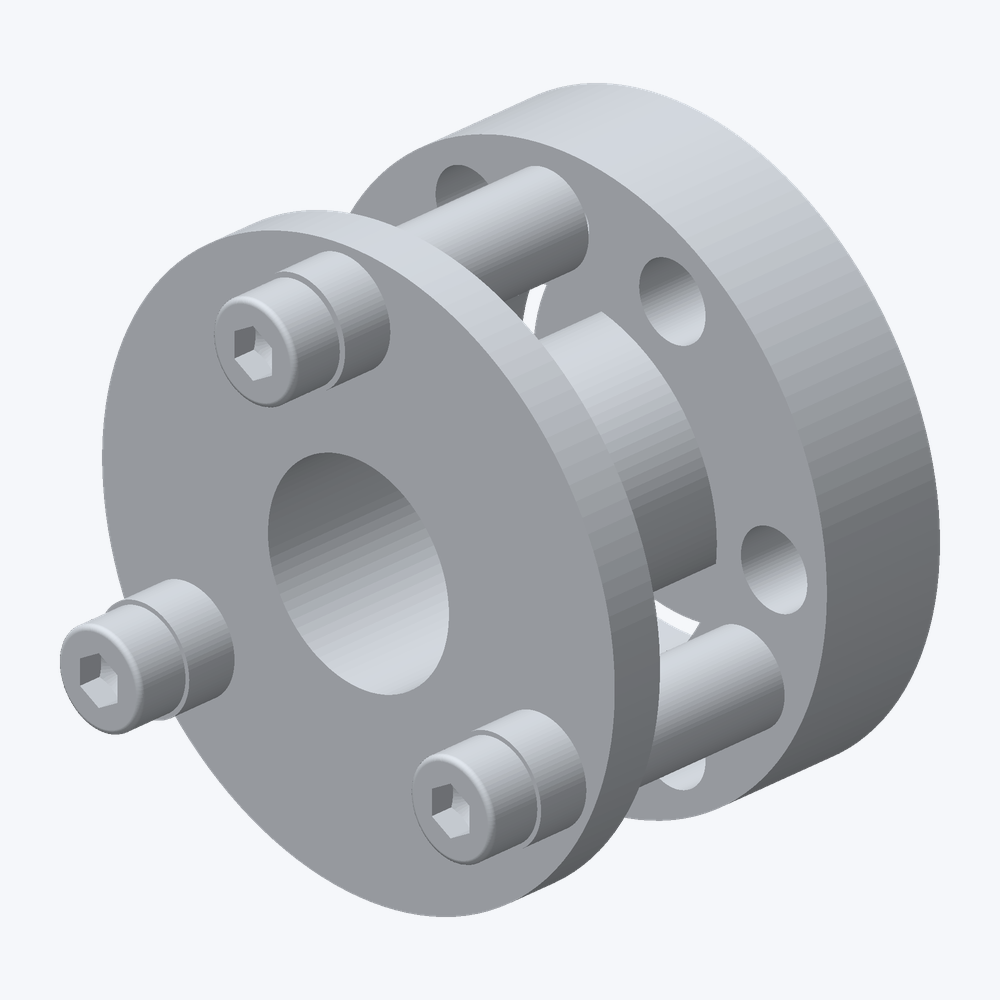

# Screen membrane

Kawabata's screen-membrane CAD, received and integrated into the PIHTI workspace on 2026-11-21.

Open **[kawabata-screen-membrane.iam](kawabata-screen-membrane.iam)** with
`PIHTI.ipj` active. The assembly contains 12 occurrences and resolves entirely
inside the workspace. This is the received design snapshot; intake verification
establishes file/reference health, not fabrication or experimental performance.

## Parts and source names

| Native part | Quantity | Delivered filename |
| --- | ---: | --- |
| `kawabata-cf34-flange.ipt` | 1 | `ICF34_frange.ipt` |
| `kawabata-screen-membrane-carrier.ipt` | 1 | `Screen-membrane.ipt` |
| `kawabata-ceramic-bush.ipt` | 3 | `Ceramics-bush.ipt` |
| `kawabata-ceramic-spacer.ipt` | 3 | `Ceramics-spacer.ipt` |
| `kawabata-membrane.ipt` | 1 | `Membrane.ipt` |
| `ContentCenter/Fastners/M3x8-SHCS.ipt` | 3 | Delivered screw reused from the shared library |

The delivered `Screen-membrane.iam` became `kawabata-screen-membrane.iam`.
Names and native references were repaired together through the archive's rename
workflow. The prefix avoids the different `Miura-membrane-experiments/membrane.ipt`.
Miura's assembly retains its own membrane.

The Pack-and-Go manifest placed the custom parts under the sender's `PALP`
folder and the screw under `ContentCenter/Fastners`. The sender's `.ipj`, its
backup, Pack-and-Go log and byte-identical redundant screw copy were removed
from the curated package. Ignored `OldVersions` material is not part of the intake.

## Verification and STEP

- Saved native reopen under `PIHTI.ipj`: no missing or external dependencies.
- Five owned parts: one solid each; all native features healthy.
- Original assembly placement and its one healthy mate constraint retained;
  the intake does not add motion constraints or certify the assembly as rigid.
- STEP copies for the assembly and five parts are in the configured STEP mirror,
  under the same `Kawabata Probe Mods/screen-membrane/` relative folder, with
  `.iam.step` or `.ipt.step` suffixes.
- Portable evidence: `.agents/intake/2026-11-21-kawabata-screen-membrane-*.json`.

The shared screw was resaved by Inventor 2027.1 during intake. Independent
OpenCascade cuts against its previous STEP give zero geometric difference in
both directions; its canonical native file is retained and its mirror refreshed.
